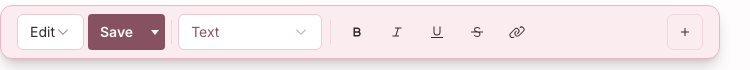

## Insert

Keep information needed to complete the current task visible. Do not hide a required warning, decision, or step in a collapsed panel.

<table>
<thead><tr><th>Code</th><th>UI</th></tr></thead>
<tbody><tr>
<td><pre data-language="md">===[Why the host saves]&#10;&#10;The host owns persistence and publication.&#10;&#10;===</pre></td>
<td>

<strong>Step 1:</strong> Select <strong>Edit</strong>. The toolbar has no Accordion insertion button.

<strong>Step 2:</strong> Enter the titled <code>===</code> section in Markdown source.

<strong>Step 3:</strong> Return to View mode and open the panel to check its content.

</td>
</tr></tbody>
</table>

## Dos and don'ts

- ✅ Do keep required actions and warnings visible outside a closed panel.
- ✅ Do put each delimiter on its own line with blank lines around the body.
- ✅ Do give separate optional questions separate titled panels.
- ❌ Don’t combine unrelated details in one panel or use an aside directive in place of an accordion.

## Preview

The example shows the rendered block and a misuse.

:::example[Accordions]

|||[Good]

Save the updated value in the host.

===[Why the host saves]

The host owns persistence and publication.

===

|||

|||[Bad]

===[How to save]

Pass `onChange` to Docs. Save the value.

===

The only required action is hidden.

|||

:::
