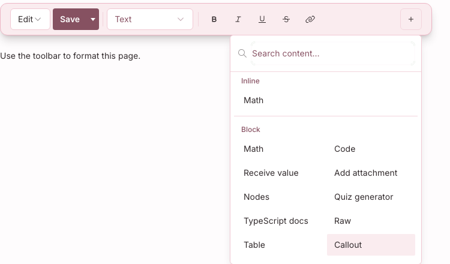

## Insert

Keep required steps and the main explanation in the reading path. Do not move them into an aside simply to make the page look shorter.

<table>
<thead><tr><th>Code</th><th>UI</th></tr></thead>
<tbody><tr>
<td><pre data-language="md">:::warning[Save outside the editor]&#10;&#10;Persist the updated value in the host.&#10;&#10;:::</pre></td>
<td>

<strong>Step 1:</strong> Select <strong>Edit</strong> and place the cursor beside the affected decision.

<strong>Step 2:</strong> Press <strong>+ Insert content</strong> and choose <strong>Callout</strong>.

<strong>Step 3:</strong> Set the kind and title, enter the message, then check it in View mode.

</td>
</tr></tbody>
</table>

## Dos and don'ts

- ✅ Do choose `note`, `tip`, `caution`, `warning`, `danger`, or `example` to match the message.
- ✅ Do use a specific title and keep nested lists, tables, or code wholly inside the aside.
- ✅ Do map imported `info` to `note` and `error` to `danger`.
- ❌ Don’t hide a required step in a callout or use danger styling for ordinary background.

## Preview

The example shows the rendered block and a misuse.

:::example[Aside]

|||[Good]

:::warning[Save outside the editor]

`onChange` reports the updated value. Persist it in the host before promising that it survives reload.

:::

|||

|||[Bad]

:::danger[Important]

Click Save. This required step appears nowhere else.

:::

|||

:::

## Variants

Choose the form that fits the reader’s task.

| Variant                                                              | Good example                                                                                                    | Bad example                               |
| -------------------------------------------------------------------- | --------------------------------------------------------------------------------------------------------------- | ----------------------------------------- |
| **Note** — Give bounded background or a definition.                  | `:::note[Who saves]` followed by “The host persists each edit.” and a closing `:::`.                            | `A required step hidden in a note`        |
| **Tip** — Offer practical advice that improves the task.             | `:::tip[Check the preview]` followed by “Preview the page before publishing.” and a closing `:::`.              | `A warning disguised as a tip`            |
| **Caution** — Flag a common pitfall before it causes an error.       | `:::caution[Check the route]` followed by “A moved leaf may break incoming links.” and a closing `:::`.         | `A routine fact framed as a pitfall`      |
| **Warning** — Call out a serious problem beside the affected action. | `:::warning[Save outside Docs]` followed by “Persist the updated value in the host.” and a closing `:::`.       | `A vague warning at the end of the page`  |
| **Danger** — Identify a forbidden or high-risk action.               | `:::danger[Do not publish secrets]` followed by “Remove credentials from public examples.” and a closing `:::`. | `Danger styling for ordinary background`  |
| **Example** — Illustrate a rule with concrete source or behavior.    | `:::example[Receive an edit]` followed by “Pass `onChange` a host save handler.” and a closing `:::`.           | `An example that is only a generic claim` |
