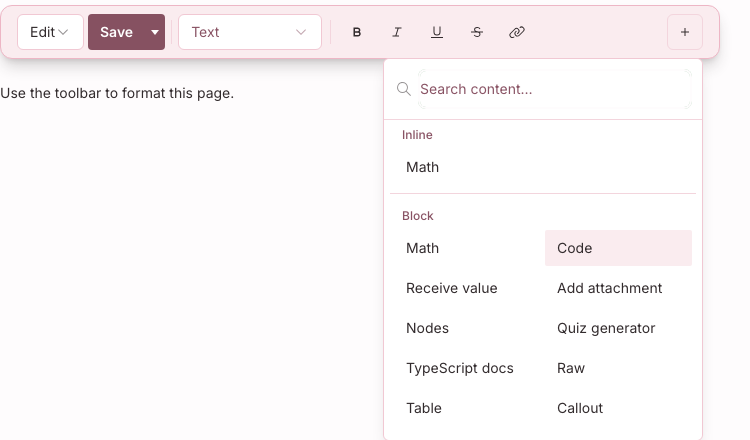

## Insert

Use inline code for a short identifier or expression. Keep the explanation in prose instead of making readers infer it from code.

<table>
<thead><tr><th>Code</th><th>UI</th></tr></thead>
<tbody><tr>
<td><pre data-language="sh">pnpm add @terra-symposium/docs</pre></td>
<td>
<p><strong>Step 1:</strong> Select <strong>Edit</strong> and place the cursor where the code belongs.</p>
<p><strong>Step 2:</strong> Press <strong>+ Insert content</strong> and choose <strong>Code</strong>.</p>

<p><strong>Step 3:</strong> Choose the language, enter the code, then check the rendered block.</p>
</td>
</tr></tbody>
</table>

## Dos and don'ts

- ✅ Do label multiline code fences with their language and explain what the code does.
- ✅ Do format long chains and arguments across lines when that improves reading.
- ❌ Don’t turn one short identifier into a fenced block.
- ❌ Don’t escape every backtick in a nested example; use a longer outer fence.
- ❌ Don’t add imports for built-in Docs blocks in Markdown.

## Preview

The example shows the rendered block and a misuse.

:::example[Code]

|||[Good]

Run the command after installing the package:

```sh
pnpm add @terra-symposium/docs
```

Use `onChange` to receive edits.

|||

|||[Bad]

```
onChange
```

Run this:

```
pnpm add @terra-symposium/docs
```

|||

:::

## Variants

Choose the form that fits the reader’s task.

| Variant                                                                                                         | Good example                                                                                                                                                         | Bad example                                      |
| --------------------------------------------------------------------------------------------------------------- | -------------------------------------------------------------------------------------------------------------------------------------------------------------------- | ------------------------------------------------ |
| **Inline code** — Name a short identifier inside a sentence.                                                    | Use `onChange` to receive an updated value.                                                                                                                          | A fenced block containing only `onChange`.       |
| **Fenced code** — Show a runnable or inspectable multiline example with a language label.                       | A `sh` fence containing `pnpm add @terra-symposium/docs` gives readers a copyable install command.                                                                   | `An unlabeled fence with no context`             |
| **Received code value** — Display code fetched by the host from an endpoint when the host supports that source. | When a host serves `/api/document-schema`, use `<Code language="json" source="/api/document-schema" />` to show that response. The endpoint must exist in that host. | `A fake endpoint presented as a working command` |
