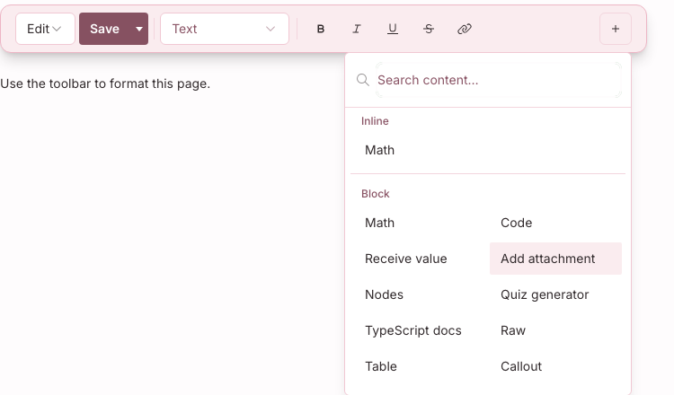

## Insert

Link to the destination when readers only need to open it. Do not embed a resource that adds no context or relies on a block the host has not registered.

<table>
<thead><tr><th>Code</th><th>UI</th></tr></thead>
<tbody><tr>
<td><pre data-language="md">&lt;Embed src="/consumer/0-configuration/2-skills/" title="Skills inventory" /&gt;</pre></td>
<td>

<strong>Step 1:</strong> For a host-managed attachment, select <strong>Edit</strong> and place the cursor where it belongs.

<strong>Step 2:</strong> Press <strong>+ Insert content</strong> and choose <strong>Add attachment</strong>.

<strong>Step 3:</strong> Choose an existing file and <strong>Visual embed</strong>. Use Markdown source for an external embed.

</td>
</tr></tbody>
</table>

## Dos and don'ts

- ✅ Do link to a destination when readers only need to open it.
- ✅ Do document host-registered custom blocks and provide a resolvable leaf ID.
- ✅ Do preserve unknown or disabled structured source in a recoverable form.
- ❌ Don’t present an unregistered component or unauthorized URL as a working embed.
- ❌ Don’t discard unknown source or display raw JSON as ordinary prose.

## Preview

The example shows the rendered block and a misuse.

:::example[Embed]

|||[Good]

The reader needs this reference in place:

<Embed src="/consumer/0-configuration/2-skills/" title="Skills inventory" />

|||

|||[Bad]

The reader only needs a destination:

<Embed src="https://example.com/" title="Click here" />

Use a descriptive link instead.

|||

:::

## Variants

Choose the form that fits the reader’s task.

| Variant                                                                                                   | Good example                                                                                                                                      | Bad example                             |
| --------------------------------------------------------------------------------------------------------- | ------------------------------------------------------------------------------------------------------------------------------------------------- | --------------------------------------- |
| **External embed** — Show a resource in the reading path when readers must inspect it here.               | `<Embed src="/consumer/0-configuration/2-skills/" title="Skills inventory" />` shows the local reference in place.                                | `An embed where a simple link would do` |
| **Reusable leaf** — Include another leaf inline only when the host registers and resolves that component. | A host that resolves leaf ID `save-guide` can render `<Leaf id="save-guide" />` in more than one page.                                            | `<Leaf id="unknown" />`                 |
| **Host custom block** — Use a registered host component with documented props.                            | If a host registers `ReleaseStatus`, `<ReleaseStatus project="docs" />` can show its status. Register and document the component before using it. | `An unregistered JSX name`              |
| **Attachment embed** — Display an existing host attachment inline.                                        | Select a host-managed screenshot with **Add attachment**, then choose **Visual embed** to show it next to the explanation.                        | `A URL the host cannot authorize`       |
