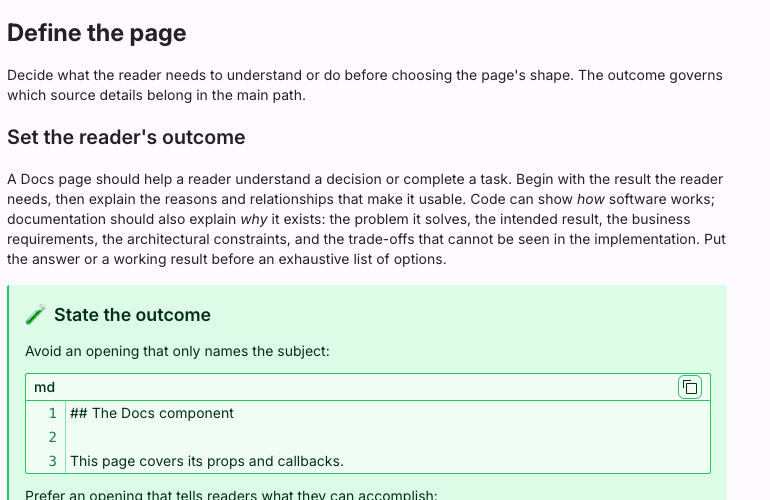
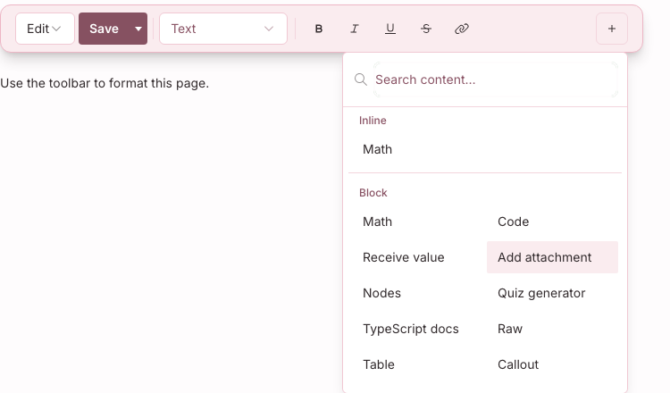

## Insert

Use text or a code block when readers need exact wording or copyable source. Avoid images that merely repeat nearby prose.

<table>
<thead><tr><th>Code</th><th>UI</th></tr></thead>
<tbody><tr>
<td><pre data-language="md"></pre></td>
<td>

<strong>Step 1:</strong> Select <strong>Edit</strong> and place the cursor where the image belongs.

<strong>Step 2:</strong> Press <strong>+ Insert content</strong> and choose <strong>Add attachment</strong>.

<strong>Step 3:</strong> Select an existing image and <strong>Visual embed</strong>, then check its alternative text.

</td>
</tr></tbody>
</table>

## Dos and don'ts

- ✅ Do use images that show a detail or relationship the text needs.
- ✅ Do write alt text that names the visible detail and keep image paths relative to the leaf.
- ✅ Do keep downloadable attachments in the leaf’s attachment view.
- ❌ Don’t use an empty alt for a meaningful image or embed a full screenshot mid-sentence.

## Preview

The example shows the rendered block and a misuse.

:::example[Image]

|||[Good]

This screenshot shows how headings and a code example appear in the live Docs workspace:

|||

|||[Bad]

Here is the page:

The image has no alt text or explanation of the detail readers should notice.

|||

:::

## Variants

Choose the form that fits the reader’s task.

| Variant                                                                                                 | Good example                                                                                                                                 | Bad example                           |
| ------------------------------------------------------------------------------------------------------- | -------------------------------------------------------------------------------------------------------------------------------------------- | ------------------------------------- |
| **Standalone image** — Show a visual that the surrounding explanation refers to.                        | `` on its own line, after a sentence naming the detail to inspect. | Unexplained decorative image          |
| **Inline image** — Place a small meaningful image within a sentence when it does not interrupt reading. | `Build status: ` places a small status icon next to its label. Use an actual small asset in the host.        | Full screenshot embedded mid-sentence |
