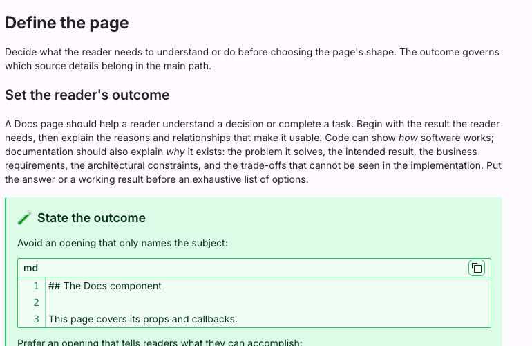

## Prose

:::example[Prose]

A heading organizes the text beneath it. **Emphasis** identifies a term, and a quote sets off wording that matters.

> The host saves the updated value.

:::

[Read the Prose guide](./prose/).

## Lists and links

:::example[Lists and links]

- The host supplies the value.
- Docs renders the value.

1. Make an edit.
2. Save the result in the host.

- [ ] Check the rendered route.

:::

[Read the Lists and links guide](./lists-and-links/).

## Code

:::example[Code]

Use `onChange` to receive edits:

```tsx
<Docs value={value} onChange={saveValue} />
```

:::

[Read the Code guide](./code/).

## Tables

:::example[Tables]

| Stage | Owner |
| ----- | ----- |
| Edit  | Docs  |
| Save  | Host  |

:::

[Read the Tables guide](./tables/).

## Images

:::example[Images]

This image shows a rendered Docs page with headings and code:



:::

[Read the Images guide](./images/).

## Math

:::example[Math]

The relationship is $E = mc^2$. A fraction can have its own line:

$$
\frac{a^2}{b_n}
$$

:::

[Read the Math guide](./math/).

## Diagrams

:::example[Diagrams]

The connection shows where an edit is saved:

<Nodes
nodes={[
{"id":"edit","type":"origin","data":{"title":"Docs edits value"}},
{"id":"save","type":"terminator","data":{"title":"Host saves result"}}
]}
edges={[
{"id":"edit-save","source":"edit","target":"save"}
]}
/>

:::

[Read the Diagrams guide](./diagrams/).

## Embeds and custom blocks

:::example[Embeds and custom blocks]

The skills inventory appears inside this page:

<Embed src="/consumer/0-configuration/2-skills/" title="Skills inventory" />

:::

[Read the Embeds and custom blocks guide](./embeds-and-custom-blocks/).

## Asides

::::example[Asides]

:::note[Who saves]

Docs reports changes through `onChange`; the host persists them.

:::

::::

[Read the Asides guide](./asides/).

## Tabs

:::example[Tabs]

|||[pnpm]

```sh
pnpm add @terra-symposium/docs
```

|||

|||[npm]

```sh
npm install @terra-symposium/docs
```

|||

:::

[Read the Tabs guide](./tabs/).

## Accordions

:::example[Accordions]

===[Why the host saves]

The host owns persistence and publication.

===

:::

[Read the Accordions guide](./accordions/).

## Quiz

:::example[Quiz]

Readers can test their understanding after reading the explanation:

<Quiz />

:::

[Read the Quiz guide](./quiz/).

## TypeScript docs

:::example[TypeScript docs]

Use the generated reference to inspect supported component props:

<TsDocs scope="@terra-symposium/docs" />

:::

[Read the TypeScript docs guide](./typescript-docs/).
