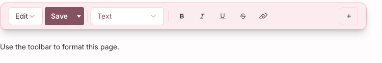

## Insert

Keep unordered facts in bullets and dependent actions in numbered steps. Use descriptive links for destinations.

<table>
<thead><tr><th>Code</th><th>UI</th></tr></thead>
<tbody><tr>
<td><pre data-language="md">- Docs renders the value.&#10;- The host saves the value.&#10;&#10;1. Make an edit.&#10;2. Save the result.&#10;&#10;- [ ] Check the route.&#10;&#10;[Read Docs setup](../../../0-configuration/0-install/)</pre></td>
<td>

<strong>Step 1:</strong> Enter list and checklist markers in Markdown source.

<strong>Step 2:</strong> For a link, select its label and press the chain-link <strong>Link</strong> button.

<strong>Step 3:</strong> Enter the destination and check the rendered link.

</td>
</tr></tbody>
</table>

## Dos and don'ts

- ✅ Do keep one idea per item and preserve order when actions depend on it.
- ✅ Do nest supporting detail under its owning item.
- ✅ Do use link labels that name the destination.
- ❌ Don’t number unordered facts or mark a checklist item complete before checking it.
- ❌ Don’t use “click here” as the only link label.

## Preview

The example shows the rendered block and a misuse.

:::example[Lists and links]

|||[Good]

- The host receives the value.
- The host chooses when to save it.

1. Pass `onChange` to Docs.
2. Save the updated value.

- [ ] Check the rendered route.
- [x] Confirm the title.

Read [Docs setup](../../../0-configuration/0-install/).

|||

|||[Bad]

1. The host receives the value.
2. The host chooses when to save it.

- Save the value.
- Receive it first.

- [x] Check the route. <!-- not checked yet -->

[Click here](../../../0-configuration/0-install/).

|||

:::

## Variants

Choose the form that fits the reader’s task.

| Variant                                                                                 | Good example                                                                                   | Bad example                                             |
| --------------------------------------------------------------------------------------- | ---------------------------------------------------------------------------------------------- | ------------------------------------------------------- |
| **Bulleted list** — Group distinct facts whose order does not matter.                   | Use `- Docs renders the value.` and `- The host saves the value.` as separate items.           | `1. The host stores the value. when no sequence exists` |
| **Numbered list** — Show actions that must happen in order.                             | Use `1. Receive an edit.` followed by `2. Save the updated value.`                             | `- Save it.  - Receive an edit.`                    |
| **Nested list** — Place supporting detail under its owning item.                        | Put ` - Use the host store.` under `- Save the value.` to make the storage detail subordinate. | `- Save.  - Host store as unrelated peers`          |
| **Checklist** — Show completion with read-only checkboxes from `[ ]` and `[x]` markers. | Use `- [ ] Verify the route.` before checking and `- [x] Verify the route.` afterward.         | `- [x] Verify the route before checking it`             |
| **Descriptive link** — Send readers to a named destination when they need it.           | `[Read Docs setup](../../../0-configuration/0-install/)` names the destination.                | `[click here](../../../0-configuration/0-install/)`     |
