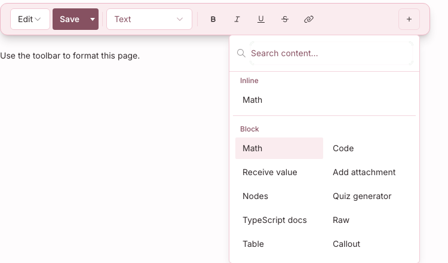

## Insert

Choose inline math for an expression in a sentence and block math when a formula needs its own line.

<table>
<thead><tr><th>Code</th><th>UI</th></tr></thead>
<tbody><tr>
<td><pre data-language="md">Energy is &#36;E = mc^2&#36;.&#10;&#10;&#36;&#36;&#10;\frac{a^2}{b_n}&#10;&#36;&#36;</pre></td>
<td>

<strong>Step 1:</strong> Select <strong>Edit</strong> and place the cursor where the expression belongs.

<strong>Step 2:</strong> Press <strong>+ Insert content</strong> to open the menu.

<strong>Step 3:</strong> Choose <strong>Math</strong> under <strong>Block</strong> for a separate formula.

<strong>Step 4:</strong> Enter the expression and check its rendered form. Choose <strong>Inline</strong> for math in a sentence.

</td>
</tr></tbody>
</table>

## Dos and don'ts

- ✅ Do use KaTeX syntax for vectors, fractions, indices, integrals, and matrices.
- ✅ Do use ordinary text when the relationship is clear without notation.
- ❌ Don't squeeze a multi-part formula into a sentence when it needs a display block.
- ❌ Don't escape a dollar sign unless it should remain literal currency or text.

## Preview

The rendered example shows an inline equation and a separate indexed fraction.

:::example[Math]

|||[Good]

The relationship is $E = mc^2$.

For the indexed fraction, use a display block:

$$
\frac{a^2}{b_n}
$$

|||

|||[Bad]

The price is \$5 per user; the unescaped form could be mistaken for math.

The full matrix is $\begin{bmatrix}a & b \\ c & d\end{bmatrix}$ inside a crowded sentence.

|||

:::

## Variants

Choose the form that fits the reader’s task.

| Variant                                                     | Good example                                                                | Bad example                              |
| ----------------------------------------------------------- | --------------------------------------------------------------------------- | ---------------------------------------- |
| **Inline math** — Keep a short expression in a sentence.    | Energy is $E = mc^2$.                                                       | A display block for one short symbol.    |
| **Block math** — Give a multi-part expression its own line. | Use a separate display block with `$$` delimiters around `\frac{a^2}{b_n}`. | A long formula squeezed into a sentence. |
