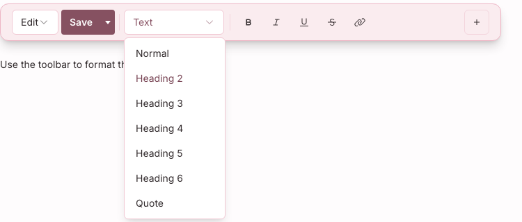
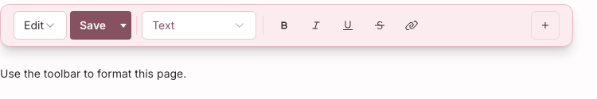

## Insert

Write ordinary text as Markdown. Use the supported rich blocks only when a relationship needs a visual form. The Docs package parses and renders this source; the host supplies routes, content, assets, permissions, and any registered custom blocks. Begin the [authoring process](../../1-authoring/) by defining the reader's purpose and voice.

A Docs leaf consists of metadata followed by a Markdown body. Keep the source readable so it can be edited, exported, and compared with what appears on the page.

<table>
<thead><tr><th>Code</th><th>UI</th></tr></thead>
<tbody><tr>
<td><pre data-language="md">## Save edits&#10;&#10;Docs reports changes through `onChange`.&#10;&#10;### Persist the value&#10;&#10;Save the updated value.</pre></td>
<td>
<p><strong>Step 1:</strong> Open a writable page and select <strong>Edit</strong>.</p>
<p><strong>Step 2:</strong> Place the cursor in a paragraph and press <strong>Block type</strong>.</p>

<p><strong>Step 3:</strong> Choose <strong>Normal</strong>, <strong>Heading 2–6</strong>, or <strong>Quote</strong>.</p>
<p><strong>Step 4:</strong> Select text and use the formatting controls for emphasis or links.</p>

<p><strong>Step 5:</strong> Enter inline code in Markdown source.</p>
</td>
</tr></tbody>
</table>

## Dos and don'ts

- ✅ Do use as few words as possible in each heading, ideally one, while still naming the section clearly.
- ✅ Do keep the structure hierarchical: start main sections at H2, nest H3 under H2, and use H4 only beneath H3 when needed.
- ✅ Do number headings when the document describes a process, so readers can follow one linear sequence.
- ✅ Do begin an H2 or H3 with a short introduction before a table or diagram.
- ✅ Do use single backticks for identifiers such as `onChange`.
- ❌ Don’t skip heading levels or add decorative emoji to headings.
- ❌ Don’t bold a sentence merely for emphasis when clearer wording would work.

## Preview

The example shows the rendered block and a misuse.

:::example[Headings and prose]

|||[Good]

## Save Docs edits

The host receives each edit through `onChange`.

### Persist the value

Save the updated value so it survives a reload.

> “The host owns storage” is a contract statement worth quoting.

|||

|||[Bad]

## Overview

#### More information

**Docs saves everything automatically.**

```text
onChange
```

|||

:::

## Variants

Choose the form that fits the reader’s task.

| Variant                                                                         | Good example                                                                                          | Bad example                                     |
| ------------------------------------------------------------------------------- | ----------------------------------------------------------------------------------------------------- | ----------------------------------------------- |
| **Paragraph** — Explain one connected idea in ordinary text.                    | “The host saves the updated value after Docs reports the edit.” is one complete idea.                 | `A sentence fragment between unrelated blocks.` |
| **H2** — Start each main section, including the first body section.             | `## Save` names the outcome in one word; `## 1. Prepare` can begin a process.                         | `## Overview` with no outcome                   |
| **H3** — Divide an H2 into meaningful subsections.                              | `### Persist` sits beneath `## Save` when persistence needs its own subsection.                       | `### Persist` before any H2                     |
| **H4** — Add a genuine third level under an H3.                                 | `#### Handle a failed save` adds a third level under a save subsection.                               | An H4 directly under an H2                      |
| **H5** — Preserve necessary deeper imported hierarchy; prefer a shallower page. | `##### Retry after a timeout` is a fifth-level heading when imported source genuinely has that depth. | An H5 for ordinary paragraph emphasis           |
| **H6** — Preserve the rare sixth level when source hierarchy requires it.       | `###### Record the final retry` is a sixth-level heading only for a necessary deeper hierarchy.       | An H6 as the first heading                      |
| **Quote** — Set off attributed or source wording that matters as a quotation.   | `> The host saves the value.` sets off wording from the source.                                       | `> Every ordinary instruction.`                 |
| **Bold** — Mark a key term only when the distinction changes meaning.           | `**required input**` distinguishes a required field from optional fields.                             | `**Every word is bold**`                        |
| **Italic** — Distinguish a term without dominating the paragraph.               | `*source document*` identifies the term being discussed.                                              | `_A whole paragraph of emphasis_`               |
| **Underline** — Preserve an imported underline when it has meaning.             | `<u>original emphasis</u>` preserves meaningful imported emphasis.                                    | `Underlined text that looks like a link`        |
| **Strikethrough** — Show a superseded value when the old value matters.         | `~~old value~~ new value` keeps the superseded value visible.                                         | `Deleted text with no replacement`              |
| **Inline code** — Identify a literal name or short expression.                  | `onChange` names the callback in “Use `onChange` to receive edits.”                                   | ``A fenced block for `onChange```               |
