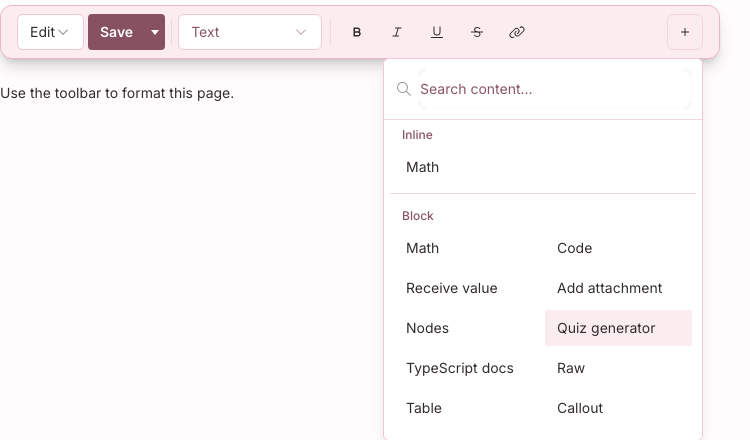

## Insert

Place a quiz after the explanation it tests so readers can answer from the page.

<table>
<thead><tr><th>Code</th><th>UI</th></tr></thead>
<tbody><tr>
<td><pre data-language="md">&lt;Quiz /&gt;</pre></td>
<td>

<strong>Step 1:</strong> Select <strong>Edit</strong> and place the cursor after the explanation.

<strong>Step 2:</strong> Press <strong>+ Insert content</strong> and choose <strong>Quiz generator</strong>.

<strong>Step 3:</strong> In View mode, choose the question count and types, then generate the quiz.

</td>
</tr></tbody>
</table>

## Dos and don'ts

- ✅ Do explain the concept before testing it.
- ✅ Do state that generated questions and results stay in the current page session.
- ❌ Don’t replace required page content with a quiz.
- ❌ Don’t promise saved results unless the host actually persists them.

## Preview

The example shows the rendered block and a misuse.

:::example[Quiz]

|||[Good]

After reading the explanation, use the quiz to practise the key concepts.

<Quiz />

|||

|||[Bad]

Putting `<Quiz />` before any explanation cannot replace the missing lesson.

|||

:::

## Variants

Choose the form that fits the reader’s task.

| Variant                                                                                          | Good example                                                                                | Bad example                                  |
| ------------------------------------------------------------------------------------------------ | ------------------------------------------------------------------------------------------- | -------------------------------------------- |
| **Multiple choice** — Test recognition among alternatives after the source explains the concept. | “Who persists an edit? A. Docs B. The host C. The browser tab” has one supported answer: B. | `An ambiguous answer set.`                   |
| **Keyword answer** — Test recall of a specific term or relationship.                             | “Which callback reports an edit?” has the keyword answer `onChange`.                        | `Require an unexplained private identifier.` |
