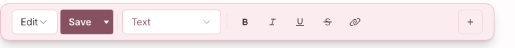

## Insert

Use headings or a list when readers need all the information, or when the sections are consecutive steps rather than alternatives.

<table>
<thead><tr><th>Code</th><th>UI</th></tr></thead>
<tbody><tr>
<td><pre data-language="md">|||[pnpm]&#10;&#10;pnpm add @terra-symposium/docs&#10;&#10;|||&#10;&#10;|||[npm]&#10;&#10;npm install @terra-symposium/docs&#10;&#10;|||</pre></td>
<td>

<strong>Step 1:</strong> Select <strong>Edit</strong>. The toolbar has no Tabs insertion button.

<strong>Step 2:</strong> Enter adjacent titled <code>|||</code> sections in Markdown source.

<strong>Step 3:</strong> Return to View mode and select each tab to check its body.

</td>
</tr></tbody>
</table>

## Dos and don'ts

- ✅ Do use tabs for alternatives that reach the same result.
- ✅ Do give each choice a useful title and complete body.
- ❌ Don’t split consecutive steps across tabs or separate related tab directives with prose.

## Preview

The example shows the rendered block and a misuse.

:::example[Tabs]

|||[Good]

The reader can choose either package manager to install the same package:

- **pnpm:** `pnpm add @terra-symposium/docs`
- **npm:** `npm install @terra-symposium/docs`

|||

|||[Bad]

“Receive an edit” and “Save the edit” are consecutive actions. Presenting them as tabs would make readers choose one and miss the other.

1. Pass `onChange` to Docs.
2. Persist the updated value in the host.

|||

:::
