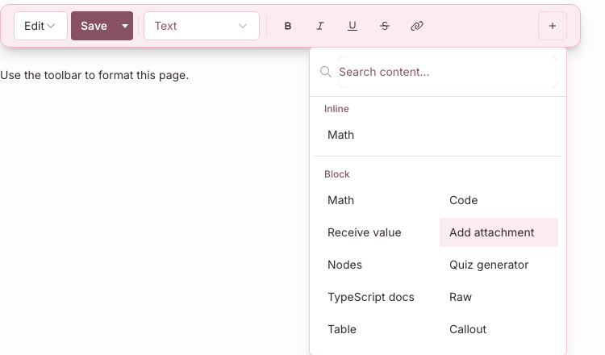

## Hierarchy

A Docs tree leads readers from a subject to a document. Design the hierarchy around the reader's questions before creating nodes. Treat supplied folders, slide decks, and lecture numbers as source labels, not approved navigation groups. Split a source when it serves two tasks; combine sources when they serve one. Reconsider the tree whenever new material changes those boundaries.

| 🧭 Level  | Purpose               | Contains                   |
| --------- | --------------------- | -------------------------- |
| 🌳 Tree   | Top-level subject     | Branches and direct leaves |
| 🪾 Branch | Related documents     | Leaves                     |
| 🍁 Leaf   | One readable document | A page body                |

:::example[Rebuild lecture groups]

Three lectures arrive as separate slide decks. Lecture 1 covers setup and editing; lectures 2 and 3 together explain one publishing task. Keep their distinct claims, but organise the reader's path by outcome:

| 📚 Source material    | Reader task | Docs leaf      |
| --------------------- | ----------- | -------------- |
| 🧰 Lecture 1: setup   | Prepare     | Get started    |
| ✏️ Lecture 1: editing | Edit        | Edit pages     |
| 🚀 Lectures 2 and 3   | Publish     | Publish a site |

The source-to-leaf map records coverage; the sidebar follows the reader's tasks rather than the lecture boundaries.

:::

|||[Local]

1. Keep `docs/index.md` as the root leaf.
2. Create a tree folder under `docs/`.
3. Create branch folders and Markdown leaves inside it.
4. Preview the sidebar and open a leaf's route.

```text
docs/
  index.md
  0-guides/
    0-setup/
      0-install.md
      1-configure.md
```

Numbered path segments set order and remain in URLs.

|||

|||[Hosted]

1. Load hierarchy, routes, and permissions from the [host adapter](/developer/component/host-integration/).
2. Choose **Add tree** in the tree selector if you have write access.
3. Add branches or direct leaves to that tree.
4. Reload the sidebar and open a leaf to verify the host saved it.

The sidebar shows the hierarchy returned by the host.

|||

## Attachments

Trees, branches, and leaves can each own attachments. Put a resource at the level whose readers need it. A node's attachment collection differs from a link or embed in a leaf's body.

| 🧭 Owner  | Resource scope           |
| --------- | ------------------------ |
| 🌳 Tree   | Shared across a subject  |
| 🪾 Branch | Shared across a group    |
| 🍁 Leaf   | Specific to one document |

### Add

Choose the owner before adding a resource.

|||[Local]

1. Put a shared file in its tree or branch folder.
2. Put a leaf-specific file beside the leaf or in its folder.
3. Link to it from every leaf that needs it.
4. Build the site and open the published asset URL.

For example, a diagram in `0-guides/` can be linked from `0-guides/0-setup/0-install.md`:

```md

```

Use relative paths. Local files are repository assets, not hosted attachment records.

|||

|||[Hosted]

1. Open **Manage attachments** on a tree or branch.
2. Select its index node or a descendant leaf.
   - On a leaf, **Files → New** can also upload a file.
3. Choose a type from the **Add Attachment** menu.
4. Upload a file or enter a URL, as the type requires.
5. Reload and confirm the owner and destination.

| 📎 Choice   | Use                            | Result                      |
| ----------- | ------------------------------ | --------------------------- |
| 🍁 Leaf     | Relate a Docs page.            | Page reference              |
| 📄 Document | Provide a download.            | Upload or imported document |
| 🖼️ Image    | Provide a diagram.             | Upload or imported image    |
| ▶️ YouTube  | Relate a video.                | Video reference             |
| 🌍 Website  | Bring a site into Docs.        | New leaf from its content   |
| 📚 TsDocs   | Relate a TypeScript reference. | Reference link              |
| 📦 Other    | Keep another file or URL.      | File or remote reference    |

The host also recognises `pdf`, `file`, `doc`, and `other` categories. These are underlying types, not extra menu choices. **Website** creates a leaf, so check its title, route, and source. The host supplies storage and authorised URLs.

|||

### Manage

A move changes attachment ownership. A body link or embed alone does not.

|||[Local]

1. Open the owning folder and identify the file and its links.
2. Rename, move, or remove the file in the repository.
3. Update relative paths in affected leaves.
4. Rebuild and open the links and asset URLs.

When exporting, copy source files with the assets they use.

|||

|||[Hosted]

1. Open **Manage attachments** for the owning tree or branch.
   - Open a leaf's **Files** menu for its file actions.
2. Select an item to open, download, rename, or remove it.
3. Drag it onto another node to move its ownership.
4. Reload and confirm the destination and authorised URL.
5. To show it inline, choose **Add attachment** in the editor.



This screenshot shows inline insertion at step 5, not the tree attachment manager. The [Embeds and custom blocks section](/consumer/1-usage/2-blocks/#embeds-and-custom-blocks) explains its visual controls. Review downloaded attachments with exported source before reuse.

|||

## Operations

Choose an operation by its effect on the hierarchy. Complete one numbered path before starting the next.

===[Create and label]

Add the needed nodes first, then name them.

| 🧭 Operation | Level              | Result                 |
| ------------ | ------------------ | ---------------------- |
| ➕ Add       | Tree, branch, leaf | New navigation node    |
| 🏷️ Name      | Tree, branch, leaf | Updated label or title |

|||[Local]

**Add**

1. Create a tree folder under `docs/`.
2. Create a branch folder inside it if needed.
3. Add one `.md` or `.mdx` file per leaf.
4. Put frontmatter before the leaf's first H2.
5. Preview the tree and open the new route.

**Name**

1. Set leaf `title` and `description` in frontmatter.
2. Add `sidebar.label` only for a shorter navigation label.
3. Rename a tree or branch folder to change its label.
4. Update links if the path changed.

```md
---
title: Install Acme
description: Set up your first Acme project.
sidebar:
  label: Install
---

## Prepare
```

|||

|||[Hosted]

**Add**

1. Choose **Add tree** from the tree selector.
   - It starts with a **General** branch and an untitled leaf.
2. Choose **Add branch** from the tree menu if needed.
3. Choose **Add leaf** from the branch menu.
4. Title, edit, and save the leaf.
5. Reload and open its route.

**Name**

1. Choose **Rename tree**, **Rename branch**, or **Rename leaf**.
2. Edit the leaf's **Description** separately if needed.
3. Reload and check label, route, and inbound links.

The standard sidebar uses the leaf title as its label.

|||

===

===[Arrange and reuse]

Order and move nodes before duplicating or merging leaves.

| 🧭 Operation | Level              | Result                   |
| ------------ | ------------------ | ------------------------ |
| 🔢 Order     | Tree, branch, leaf | New sibling order        |
| ↔️ Move      | Leaf or branch     | New parent or position   |
| 📋 Duplicate | Leaf               | Copy or shared reference |
| 🔀 Merge     | Leaves             | One destination leaf     |

|||[Local]

**Order**

1. Prefix tree, branch, and leaf names with numbers.
2. Rebuild and check sibling order.
3. Update links after any path change.

`2-publish.md` sorts before `10-reference.md`. Prefixes disappear from labels but remain in URLs. Do not use `order` or `sidebar.order` in frontmatter.

**Move**

1. Move the leaf file or whole branch folder.
2. Update inbound links and relative asset paths.
3. Rebuild and open affected routes.

**Duplicate**

1. Copy the leaf to a new filename.
2. Revise its title, description, body, and links.
3. Check its relative asset paths.

**Merge**

1. Combine distinct content in reading order.
2. Keep the assets needed by the merged leaf.
3. Update links and remove superseded files.
4. Rebuild and check the destination.

|||

|||[Hosted]

**Order**

1. Drag a leaf or branch by **Reorder item**.
2. Drop it before or after a sibling.
3. Reload and check the order.

The tree selector has no drag handle; the host must return trees in the intended order.

**Move**

1. Drag a leaf onto its destination branch or beside a leaf there.
2. Reload and check its route and attachments.

Branches reorder within their tree. The sidebar cannot move them across trees.

**Duplicate**

1. Choose **Duplicate leaf**.
2. Select **By content** for a copy or **By reference** when supported.
3. Give it a distinct title and check its route.

**Merge**

1. Select two or more leaves with Command or Shift.
2. Choose **Merge leaves** and name the result.
3. Review headings, links, and attachments.

The first leaf in sidebar order becomes the destination. The others are removed.

|||

===

===[Hide, remove, and export]

Check routes and attachments before concealing, deleting, or copying a node.

| 🧭 Operation | Level              | Result                  |
| ------------ | ------------------ | ----------------------- |
| 🙈 Hide      | Leaf               | Removed from navigation |
| 🗑️ Remove    | Tree, branch, leaf | Deleted node            |
| 📦 Export    | Tree, branch, leaf | Downloaded source       |

|||[Local]

**Hide**

1. Set `sidebar: { hidden: true }` in leaf frontmatter.
2. Rebuild and check navigation and search.
3. Protect private content at the web host.

The direct URL still works.

**Remove**

1. Delete the leaf file or empty folder.
2. Keep `docs/index.md` as the root leaf.
3. Update inbound links and rebuild.

**Export**

1. Copy the leaf file or folder from `docs/`.
2. Copy nearby assets with the same relative paths.
3. Open exported links before reuse.

|||

|||[Hosted]

**Hide**

1. Have the host omit the leaf from its supplied tree.
2. Apply search and access rules in the host.
3. Check the direct route with a reader account.

The standard sidebar has no **Hide leaf** action. Omitting a node does not block its route.

**Remove**

1. Choose **Delete leaf**, **Delete branch**, or **Delete tree**.
2. Review the confirmation.
3. Check affected links, routes, and attachments.

**Export**

1. Choose **Download leaf**, **Download branch**, or **Download tree**.
2. Inspect downloaded source and attachments.
3. Open its links before reuse.

|||

===

## Check the result

Follow the changed path as a reader. Check the tree, branch, leaf, and attachments at each level.

|||[Local]

1. Build the site and check sidebar order and direct routes.
2. Open links and asset URLs from affected leaves.
3. Confirm hidden leaves are absent from navigation and search.
4. Check direct URLs and the web host's access rules.

|||

|||[Hosted]

1. Reload the workspace with editor access.
2. Inspect changed nodes and attachment counts.
3. Open representative files and references as a reader.
4. Confirm the host denies content without reader access.

|||
