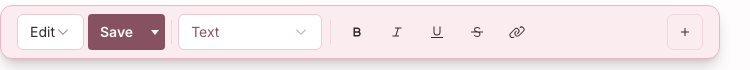

## Insert

Keep information needed to complete the current task visible. Do not hide a required warning, decision, or step in a collapsed panel. Use an accordion when several items in the same category need separate titles and supporting detail: repeated examples, questions, cases, or sources. A run of callouts with the same purpose is a cue to group them as accordion items. Keep an example aside inside an item when its title names the case and the aside illustrates it.

<table>
<thead><tr><th>💻 Code</th><th>🖥️ UI</th></tr></thead>
<tbody><tr>
<td><pre data-language="md">===[Why the host saves]&#10;&#10;The host owns persistence and publication.&#10;&#10;===</pre></td>
<td>
<p><strong>Step 1:</strong> Select <strong>Edit</strong>. The toolbar has no Accordion insertion button.</p>

<p><strong>Step 2:</strong> Enter the titled <code>===</code> section in Markdown source.</p>
<p><strong>Step 3:</strong> Return to View mode and open the panel to check its content.</p>
</td>
</tr></tbody>
</table>

## Dos and don'ts

- ✅ Do keep required actions and warnings visible outside a closed panel.
- ✅ Do put each delimiter on its own line with blank lines around the body.
- ✅ Do title each question, example, or case in one category.
  - Give each its own panel.
- ✅ Do group repeated items in titled panels.
  - Replace a stack of callouts with one accordion.
- ✅ Do put an example aside inside its related panel.
  - Keep its own boundary when the example needs one.
- ❌ Don’t combine unrelated details in one panel.
  - An aside does not replace an accordion.

:::example[Group related examples]

Repeated heading examples become one navigable set. Each item explains one rule and contains its example:

````md
===[Concise hierarchy]

Keep the action and its detail at the right levels.

:::example[Save edits]

```md
## Save edits

### Handle errors
```

:::

===

===[Number a process]

Number headings only when readers follow a sequence.

:::example[Prepare then edit]

```md
## 1. Prepare

## 2. Edit
```

:::

===
````

Keep a required action or serious warning outside the collapsed items.

:::

## Preview

The example shows the rendered block and a misuse.

:::example[Accordions]

|||[Good]

Save the updated value in the host.

===[Why the host saves]

The host owns persistence and publication.

===

|||

|||[Bad]

===[How to save]

Pass `onChange` to Docs. Save the value.

===

The only required action is hidden.

|||

:::
