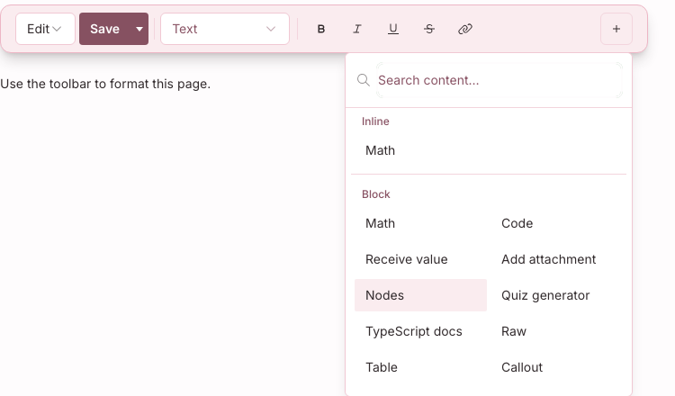

## Insert

Use a list for a short linear sequence and a table for repeated attributes. Do not add a diagram when its connections explain nothing beyond the labels.

<table>
<thead><tr><th>💻 Code</th><th>🖥️ UI</th></tr></thead>
<tbody><tr>
<td><pre data-language="md">&lt;Nodes&#10;nodes={[&#10;{"id":"start","type":"origin","data":{"title":"Host supplies value"}},&#10;{"id":"saved","type":"terminator","data":{"title":"Host saves result"}}&#10;]}&#10;edges={[&#10;{"id":"flow","source":"start","target":"saved"}&#10;]}&#10;/&gt;</pre></td>
<td>

<strong>Step 1:</strong> Select <strong>Edit</strong> and place the cursor where the diagram belongs.

<strong>Step 2:</strong> Press <strong>+ Insert content</strong> and choose <strong>Nodes</strong>.

<strong>Step 3:</strong> Edit node titles, kinds, IDs, and connections; check the rendered graph.

</td>
</tr></tbody>
</table>

## Dos and don'ts

- ✅ Do choose a diagram when connections explain more than a list would.
- ✅ Do keep complete node and edge arrays in the directive.
  - Put each object on one line.
- ✅ Do keep prose outside the JSON.
  - Inspect labels, direction, spacing, and controls.
- ❌ Don’t point an edge to a missing node.
  - Do not replace required data with empty arrays.

## Preview

The example shows the rendered block and a misuse.

:::example[Nodes]

|||[Good]

<Nodes
nodes={[
{"id":"start","type":"origin","data":{"title":"Host supplies value"}},
{"id":"edit","type":"process","data":{"title":"Docs edits value"}},
{"id":"saved","type":"terminator","data":{"title":"Host saves result"}}
]}
edges={[
{"id":"a","source":"start","target":"edit"},
{"id":"b","source":"edit","target":"saved"}
]}
/>

|||

|||[Bad]

One node labelled “Step 1” adds no relationship beyond its label.

|||

:::

## Variants

Choose the form that fits the reader’s task.

| Variant                                                       | Good example                                                               | Bad example                             |
| ------------------------------------------------------------- | -------------------------------------------------------------------------- | --------------------------------------- |
| 🟢 **Origin** — Name where a process starts.                  | `{"id":"start","type":"origin","data":{"title":"Host supplies value"}}`    | `An origin at every intermediate step`  |
| ⚙️ **Process** — Show an action or transformation.            | `{"id":"edit","type":"process","data":{"title":"Docs edits value"}}`       | `A process label with no action`        |
| 🏁 **Terminator** — Name the outcome or endpoint.             | `{"id":"saved","type":"terminator","data":{"title":"Host saves result"}}`  | `An unexplained end node`               |
| 🛑 **Terminal** — Mark a hard stop in a flow.                 | `{"id":"stop","type":"terminal","data":{"title":"Stop on error"}}`         | `A terminal for an intermediate action` |
| 🔀 **Decision** — Show a branch with meaningful alternatives. | `{"id":"saved?","type":"decision","data":{"title":"Was the edit saved?"}}` | `A decision with one unexplained exit`  |
| 📦 **Data** — Represent an input or output value.             | `{"id":"value","type":"data","data":{"title":"Updated document"}}`         | `A data node describing a decision`     |
| 📝 **Note** — Add short context attached to the graph.        | `{"id":"note","type":"note","data":{"title":"Host owns storage"}}`         | `A long paragraph inside a graph`       |
| 🗂️ **Group** — Contain nodes that belong to one stage.        | `{"id":"host","type":"group","data":{"title":"Host operations"}}`          | `A group of unrelated stages`           |
| 🗄️ **ERD** — Represent a data entity in a data model.         | `{"id":"document","type":"erd","data":{"title":"Document record"}}`        | `An ERD node for a simple action`       |
