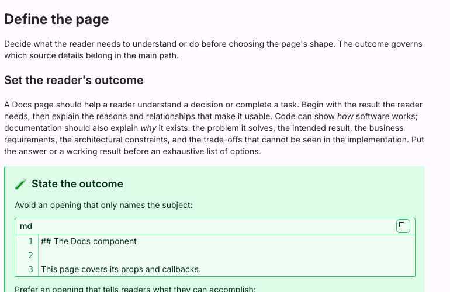

## Rules

Before authoring a leaf, read every block guide in this reference so the choice of blocks is informed. Follow each relevant rule for every instance of its block, including examples and nested blocks. In particular:

- Keep each list item at 75 characters or fewer.
  - Move supporting detail into sublist points.
- Put meaningful emojis on a table's independent axis.
  - Use its first row, first column, or both as appropriate.
- Check each block's source form and rendered result.

The [Lists and links](./lists-and-links/) and [Tables](./tables/) guides define the limits and examples. A green build does not replace these checks.

## Frontmatter

Start each repository-backed leaf with a title and description. The [Frontmatter guide](./frontmatter/) explains supported metadata and how filenames set navigation order.

## Choose a block

Use plain prose for an idea that needs no special layout. Choose a block for the relationship readers need to see:

| Relationship                                                     | Block                       |
| ---------------------------------------------------------------- | --------------------------- |
| 🔁 Repeated properties                                           | Table                       |
| ➡️ Sequence or dependency                                        | Diagram                     |
| 🔀 Alternative views                                             | Tabs                        |
| 🗂️ Repeated items in one category, such as examples or questions | Accordion with titled items |
| 💡 One bounded example or constraint                             | Aside                       |

Several adjacent callouts of the same kind are a cue to group them into accordion items, with each example aside inside its item. Keep required steps and warnings visible. Explain what readers should notice in an image and give it informative alt text.

Use bullets for unordered items and numbers for steps. A long list may be clearer as a table when its items share comparable attributes. Give links descriptive labels. Keep code examples runnable and label their fenced language; break long method chains and arguments across lines so readers can copy them. Use inline or block math according to the expression's length, and put diagram nodes and edges inline in the current Docs form.

## Prose

:::example[Prose]

A heading organizes the text beneath it. **Emphasis** identifies a term, and a quote sets off wording that matters.

> The host saves the updated value.

:::

[Read the Prose guide](./prose/).

## Lists and links

:::example[Lists and links]

- The host supplies the value.
- Docs renders the value.

1. Make an edit.
2. Save the result in the host.

- [ ] Check the rendered route.

:::

[Read the Lists and links guide](./lists-and-links/).

## Code

:::example[Code]

Use `onChange` to receive edits:

```tsx
<Docs mode="edit" value={value} onChange={saveValue} />
```

:::

[Read the Code guide](./code/).

## Tables

:::example[Tables]

| Stage   | Owner |
| ------- | ----- |
| ✏️ Edit | Docs  |
| 💾 Save | Host  |

:::

[Read the Tables guide](./tables/).

## Images

:::example[Images]

This image shows a rendered Docs page with headings and code:



:::

[Read the Images guide](./images/).

## Math

:::example[Math]

The relationship is $E = mc^2$. A fraction can have its own line:

$$
\frac{a^2}{b_n}
$$

:::

[Read the Math guide](./math/).

## Diagrams

:::example[Diagrams]

The connection shows where an edit is saved:

<Nodes
nodes={[
{"id":"edit","type":"origin","data":{"title":"Docs edits value"}},
{"id":"save","type":"terminator","data":{"title":"Host saves result"}}
]}
edges={[
{"id":"edit-save","source":"edit","target":"save"}
]}
/>

:::

[Read the Diagrams guide](./diagrams/).

## Embeds and custom blocks

:::example[Embeds and custom blocks]

The skills inventory appears inside this page:

<Embed src="/consumer/1-usage/0-tree/" title="Tree" />

:::

[Read the Embeds and custom blocks guide](./embeds-and-custom-blocks/).

## Asides

:::example[Asides]

:::note[Who saves]

Docs reports changes through `onChange`; the host persists them.

:::

:::

[Read the Asides guide](./asides/).

## Tabs

:::example[Tabs]

|||[pnpm]

```sh
pnpm add @terra-symposium/docs
```

|||

|||[npm]

```sh
npm install @terra-symposium/docs
```

|||

:::

[Read the Tabs guide](./tabs/).

## Accordions

:::example[Accordions]

===[Why the host saves]

The host owns persistence and publication.

===

:::

[Read the Accordions guide](./accordions/).

## Quiz

:::example[Quiz]

Readers can test their understanding after reading the explanation:

<Quiz />

:::

[Read the Quiz guide](./quiz/).

## TypeScript docs

:::example[TypeScript docs]

Use the generated reference to inspect supported component props:

<TsDocs scope="@terra-symposium/docs" />

:::

[Read the TypeScript docs guide](./typescript-docs/).
