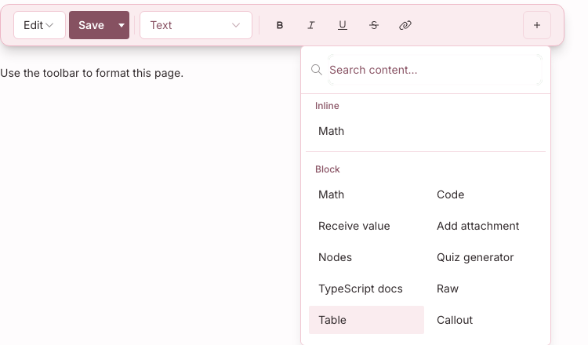

## Insert

Use prose or a list for a single point or a sequence of actions. A table adds work when rows do not share meaningful columns.

Put a meaningful emoji on the independent variable's axis so readers can scan the categories. When columns are the choices, prefix each first-row header. When rows are the cases, prefix each first-column label. Use both when both axes define categories. Do not scatter emojis through dependent-value cells; choose an icon that helps identify the category.

<table>
<thead><tr><th>💻 Code</th><th>🖥️ UI</th></tr></thead>
<tbody><tr>
<td><pre data-language="md">| Stage     | Owner |&#10;| --------- | ----- |&#10;| 🖥️ Render | Docs  |&#10;| 💾 Save   | Host  |</pre></td>
<td>
<p><strong>Step 1:</strong> Select <strong>Edit</strong> and place the cursor where the comparison belongs.</p>
<p><strong>Step 2:</strong> Press <strong>+ Insert content</strong> and choose <strong>Table</strong>.</p>

<p><strong>Step 3:</strong> Fill headers and cells, then inspect wrapping in View mode.</p>
</td>
</tr></tbody>
</table>

## Dos and don'ts

- ✅ Do use a table only when rows share meaningful columns.
- ✅ Do keep headers short and unbolded, and preserve row and cell structure.
- ✅ Do put meaningful emojis in the first row or column by axis.
- ✅ Do use structured table data only when needed.
  - Preserve rich Portable Text cells supplied by the host.
- ❌ Don’t use HTML for an ordinary two-column grid.
  - Do not scatter decorative icons.

## Preview

The example shows the rendered block and a misuse.

:::example[Table]

|||[Good]

| Stage     | Owner |
| --------- | ----- |
| 🖥️ Render | Docs  |
| 💾 Save   | Host  |

|||

|||[Bad]

| Save                                        |
| ------------------------------------------- |
| Save in the host, then reload, then verify. |

A paragraph or ordered list is clearer for this sequence.

|||

:::

## Variants

Choose the form that fits the reader’s task.

| Variant                                                                                           | Good example                                                                                                                                                                       | Bad example                             |
| ------------------------------------------------------------------------------------------------- | ---------------------------------------------------------------------------------------------------------------------------------------------------------------------------------- | --------------------------------------- |
| 📋 **Pipe table** — Compare simple rows with repeated columns.                                    | A table with **Stage** and **Owner** headers compares **Render / Docs** with **Save / Host**.                                                                                      | A table for one isolated fact.          |
| 🧱 **HTML table** — Preserve explicit HTML structure only when the simple grid cannot express it. | `<table><caption>Owners</caption><thead><tr><th>Stage</th><th>Owner</th></tr></thead><tbody><tr><td>💾 Save</td><td>Host</td></tr></tbody></table>` preserves an explicit caption. | `HTML for an ordinary two-column grid`  |
| 🧩 **Structured table** — Keep editable Portable Text cells supplied by a host.                   | Insert a two-column table in the editor, label the columns **Stage** and **Owner**, then add **Save** and **Host** in one row.                                                     | `Flattening rich cell content to prose` |

### Axis examples

The axis that names the independent category receives the emoji:

```md
| 🧭 Route | 🧑 Reader | ⚙️ Purpose   |
| -------- | --------- | ------------ |
| /start   | New user  | Install Docs |

| Stage     | Owner |
| --------- | ----- |
| 🖥️ Render | Docs  |
| 💾 Save   | Host  |
```

The first table compares columns; the second compares stages by row.
