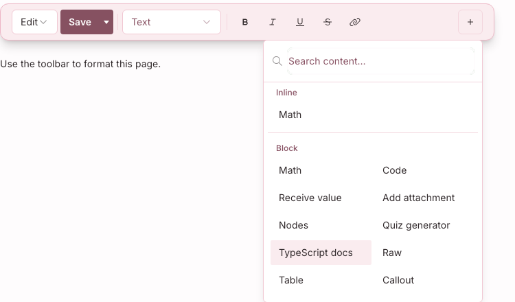

## Insert

Name a host-supported scope and explain what readers should check in the generated reference.

<table>
<thead><tr><th>💻 Code</th><th>🖥️ UI</th></tr></thead>
<tbody><tr>
<td><pre data-language="md">&lt;TsDocs scope="@terra-symposium/docs" /&gt;</pre></td>
<td>

<strong>Step 1:</strong> Select <strong>Edit</strong> and place the cursor after the API explanation.

<strong>Step 2:</strong> Press <strong>+ Insert content</strong> and choose <strong>TypeScript docs</strong>.

<strong>Step 3:</strong> Choose a host-supported scope and check the reference in View mode.

</td>
</tr></tbody>
</table>

## Dos and don'ts

- ✅ Do name the API readers should inspect first.
  - Place this before the generated reference.
- ✅ Do confirm that the scope exists at the published route.
- ❌ Don’t use a full reference for one trivial call.
  - Use a short code example instead.

## Preview

The example shows the rendered block and a misuse.

:::example[TypeScript docs]

|||[Good]

## Component API

Use this reference to check the props after reading the edit-and-save flow.

<TsDocs scope="@terra-symposium/docs" />

|||

|||[Bad]

<TsDocs scope="" />

An empty or unavailable scope gives the reader no usable reference.

|||

:::
