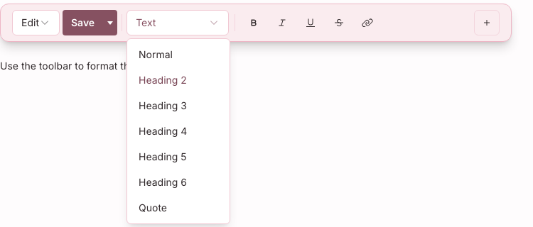

## Reader

Write for a person using a product to accomplish a task. Consumer documentation is a **user guide**: it explains what to do, what the interface will show, and how to tell the task worked. It supports the user's goal; it is not product copy or a feature pitch.

## Goal

State the result first, then give ordered actions with the information needed at each decision. Include prerequisites, labels exactly as they appear, expected results, recovery steps for likely errors, and a final check. Do not make a screenshot carry instructions that should be written as text.

## Tone

Be neutral, direct, and reassuring. Address the reader as “you”; use the exact button, menu, field, and status labels they can see. Explain a term before using it and avoid marketing language or unexplained product jargon.

## Patterns

Use the tutorial pattern when readers need ordered instructions for an interface task or its source-file equivalent.

### Tutorials

Use a step table for a tutorial when each action has a useful screenshot or source example. Put the instruction in the left column and its corresponding screenshot or source example in the right column. Use one row per step; crop screenshots to the relevant control, preserve readable labels, and add alt text that describes the meaningful state. Keep each step complete when the image is unavailable.

Wrap equivalent interface and Markdown paths in Docs tabs so readers can select the path they use:

|||[User interface]

| Instruction                                                                    | Screenshot                                                                                 |
| ------------------------------------------------------------------------------ | ------------------------------------------------------------------------------------------ |
| In the Docs editor, type **Setup** on an empty line, select it, and choose **Text** > **Heading 2**. Confirm that **Setup** appears as a level-two heading. |  |

|||

|||[Markdown]

| Instruction                                                                                   | Markdown        |
| --------------------------------------------------------------------------------------------- | --------------- |
| Add `## Setup` on its own line. Confirm that **Setup** appears as a level-two heading.         | `## Setup`      |

|||

:::example[Tutorial with a decision and recovery]

**Before you start:** [Verified prerequisite].

1. Choose **[control]**. Confirm **[expected result]**.
2. For **[condition]**, choose **[A]**; otherwise **[B]**. Confirm **[result]**.
3. Choose **[final control]**. Confirm **[completion state]**.

If **[known error]** appears, use **[verified recovery]**, then repeat step [number]. This is a structure placeholder: replace every bracket with the product's tested labels and behavior.

:::

## Sources

Verify each procedure against the current product release or API. Capture screenshots from the same release and state as the instructions, remove personal or confidential data, and keep the original source and tested version in the authoring record.

## Validation

- Match the visible interface or verified API wording and order.
- Give every step one action and its expected result.
- Show a recovery path when an error can prevent completion.
- Keep screenshots current, focused, accessible, and secondary to text.
- Ask a new reader to follow the guide without help; repair every pause.
