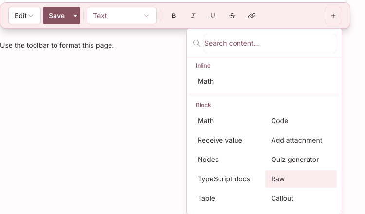

```tsx
import { Docs } from '@terra-symposium/docs';
import type { DocsProps, DocsValue, DocsMode } from '@terra-symposium/docs';
import '@terra-symposium/docs/style.css';
```

`DocsValue` is a Portable Text block array. The editor and viewer support paragraphs, headings 2–6, quotes, bold, italic, underline, strikethrough, links, and the reusable rich blocks below. The host controls persistence and authorization.

| Prop        | Edit mode               | View mode               |
| ----------- | ----------------------- | ----------------------- |
| `mode`      | Required: `edit`        | Required: `view`        |
| `value`     | Current document        | Document to render      |
| `onChange`  | Required; reports edits | Not accepted            |
| `className` | Optional wrapper class  | Optional wrapper class  |
| `blocks`    | Per-block opt-out flags | Per-block opt-out flags |

## Rich blocks

Markdown tabs (`|||[Title]`) and accordions (`===[Title]`) render with the shared Styling controls. The editor inserts and saves these as Markdown. Existing structured Portable Text records in consumer-owned stores are converted to Markdown when loaded; this compatibility adapter does not add structured tab or accordion editor controls. Repository-owned Docs pages use the Markdown syntax directly. The remaining block registry includes tables, callouts, code, images, embeds, math (including inline math), diagrams, raw Markdown, and TypeScript documentation. Code is document content; there is no raw document-code mode.

To disable a member in one instance, set its flag to `false`:

```tsx
<Docs mode="edit" value={value} onChange={setValue} blocks={{ embed: false, nodes: false }} />
```

The same options can be passed to `renderMarkdown(markdown, blocks)`. Unknown or disabled structured source stays visible as escaped source, so it is not silently discarded.

`markdownToDocsValue(source)` and `docsValueToMarkdown(value)` bridge local Markdown and visual editing. The supported representations are:

- Paragraphs, headings 2–6, quotes, inline emphasis, links, and inline math use Markdown syntax. A level-one heading follows the original Terra contract and imports as normal text.
- Ordered and unordered lists, including nested list levels, use Markdown list syntax.
- GFM pipe tables and native HTML tables import as editable table blocks and export as pipe tables. Add an optional bold Markdown caption on the line before the table.
- A standalone `` paragraph imports as an image block. An image embedded within prose remains in the paragraph source.
- Fenced code blocks with a language identifier are the authored block syntax. Single backticks remain inline code. Display math uses `$$` delimiters.
- `:::` is reserved for Astro Starlight asides: `note`, `tip`, `caution`, `danger`, `example`, and `warning`, with an optional `[Title]`, Markdown body, and a closing `:::`.
- Accordions use `===[Title]` and tabs use `|||[Title]`. Put the opening delimiter on its own line, a blank line before the Markdown body, and another blank line before the closing delimiter. Keep the closing delimiter on its own line.
- Node diagrams use `<Nodes direction={"TB"} nodes={[...]} edges={[...]} />`; embedded content uses `<Embed src="..." title="..." />`.

Unknown Markdown tokens and disabled block syntax are kept as raw source. Store images and attachments beside the Markdown file and use relative paths.

## Workspace shell

`DocsSiteLayout` (React) and `@terra-symposium/docs/site-layout.astro` are static-host adapters around the same Docs workspace used by the local and remote providers. They render the tree selector, nested branches and leaves, document header, and View/Attachments toolbar. Pass `trees` as an ordered array of `{ title, branches: [{ title, leaves: [{ title, href, description?, updatedAt?, attachments? }] }] }`. Each attachment belongs to its leaf and appears in Attachments mode. Existing hosts can continue passing the legacy `sections` and `groups` shape while migrating.

Pass `breadcrumbParent={{ title, href }}` to a static host when a page has a parent reference. The breadcrumb appears above the document body and links back to that parent.

Local hosts use `DocsLocalWorkspace` and remain read-only in the browser. Remote hosts mount `DocsWorkspace` with a `DocsHostAdapter`; the adapter supplies capabilities and routes all reads and mutations to the host. The shared UI does not decide identity or authorization.

## Raw source

A raw block preserves source that Docs cannot safely interpret. It displays the original Markdown or MDX as source, except a horizontal-rule token, which renders as a divider. Use it as a recovery format and resolve the unsupported content with the host before relying on it as a live feature.

:::example[Raw source]

|||[Good]

<UnknownWidget />

Keep the original source recoverable while checking the missing renderer.

|||

|||[Bad]

Unknown widget.

This loses the original source and suggests the widget is working.

|||

:::

:::tip[Authoring]

|||[Code]

```md
<UnknownWidget />
```

|||

|||[UI]

1. Select **Edit** and place the cursor where the literal source belongs.
2. Press **+ Insert content** and choose **Raw**.
3. Enter the source and check that it remains visible verbatim. Use prose, a code fence, or a supported block for ordinary Markdown.



|||

:::

:::note[Syntax]

- Preserve unsupported source as a typed `raw` block when ordinary Markdown would change it.
- A standalone horizontal-rule token renders as a divider; other raw source displays verbatim.

:::

:::caution[Constraints]

- Raw source is preserved for recovery, not executed as a component.
- Do not describe an unregistered block as a working interactive feature.

:::

### Variants

Choose the variant that matches the reader's task; the examples show the intended form and a misuse.

| Variant                                                                              | Good example                                                                           | Bad example                                             |
| ------------------------------------------------------------------------------------ | -------------------------------------------------------------------------------------- | ------------------------------------------------------- |
| Unknown syntax <br/> Preserve unrecognized or disabled source for recovery.          | <code>Keep the complete original token.</code>                                         | <code>Drop it or present it as a live component.</code> |
| Horizontal rule <br/> Render a standalone `---`, `***`, or `___` token as a divider. | <code>Use a rule only for a meaningful break.</code>                                   | <code>Use dividers between every paragraph.</code>      |
| Typed payload <br/> Preserve fields that plain Markdown would lose.                  | <code>`&lt;DocsBlock type=&quot;raw&quot; data={...} /&gt;` with original data.</code> | <code>Rewrite the data as ordinary prose.</code>        |
